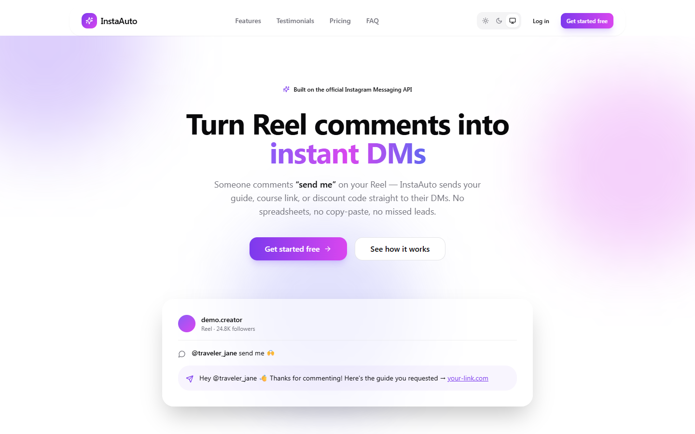
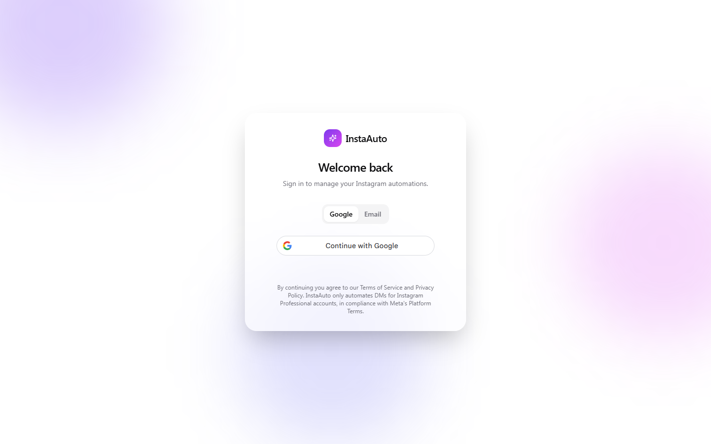
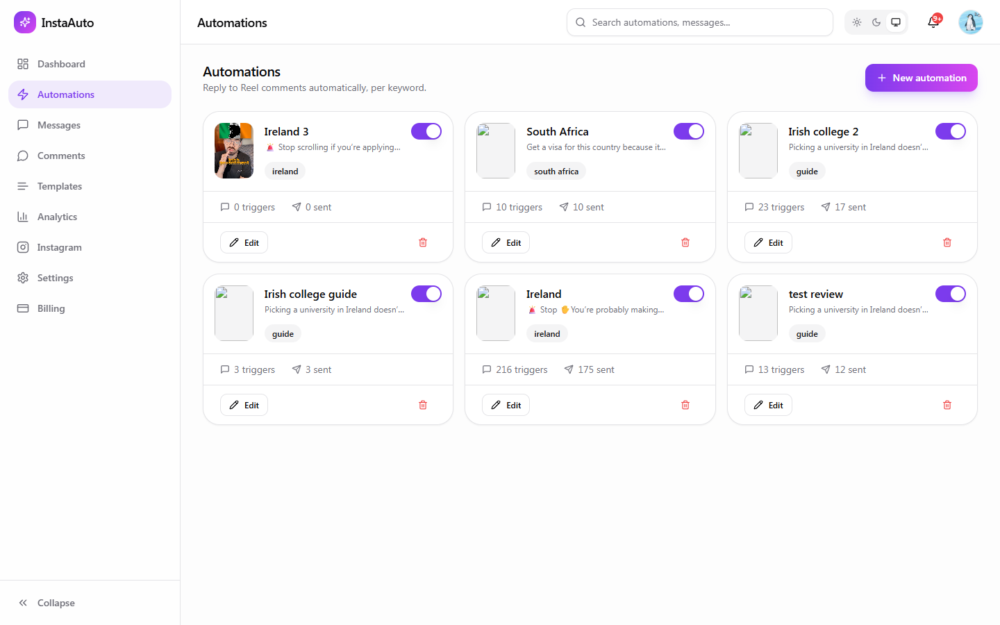
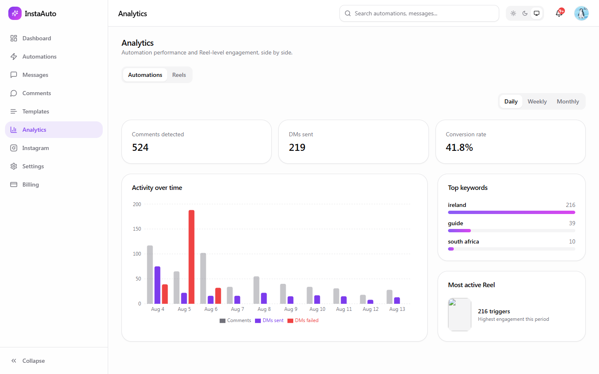

# InstaAuto

Automate Instagram DM replies when someone comments a trigger keyword on one of your Reels —
built on the official Meta Graph API, Instagram Messaging API, and Instagram Webhooks.

> Comment **"send me"** on a Reel → InstaAuto automatically sends:
> _"Hey 👋 Thanks for commenting! Here is the guide you requested. https://your-link.com"_

**Live app:** [instaautomation-1da00.web.app](https://instaautomation-1da00.web.app)

Use it from your AI assistant too - see [AI integrations (MCP)](#ai-integrations-mcp).

---

## Screenshots

| Landing | Login |
| --- | --- |
|  |  |

| Automations | Analytics |
| --- | --- |
|  |  |

---

## Stack

| Layer      | Tech                                                                                     |
| ---------- | ----------------------------------------------------------------------------------------- |
| Frontend   | React 19, TypeScript, Vite, Tailwind CSS, Framer Motion, React Router, React Query, Zustand, React Hook Form + Zod, shadcn/ui-style components, Recharts, Lucide |
| Backend    | Node.js, Express, TypeScript, Prisma ORM, PostgreSQL, JWT auth, Google OAuth, Stripe       |
| Deployment | Firebase Hosting (frontend) + Firebase Cloud Functions v2 (backend), GitHub Actions CI     |

## Monorepo layout

```
automation/
├── apps/
│   ├── web/                 # React + Vite frontend
│   └── functions/           # Express API, wrapped as a Firebase Cloud Function
├── packages/
│   └── shared/              # Shared Zod schemas, enums, constants, DTO types
├── firebase.json            # Hosting rewrites + Functions config
└── .github/workflows/ci.yml
```

---

## Why Instagram automation is built this way

Instagram does **not** allow arbitrary automated DMs from generic bots. InstaAuto only works
within Meta's supported, compliant surface:

- Requires an **Instagram Professional (Business or Creator)** account, connected via **Instagram
  Login** (no linked Facebook Page required).
- Uses the **Instagram Webhooks** `comments` field to detect new comments in real time.
- Replies via the **Private Replies API** (`POST /{ig-comment-id}/private_replies`) — the
  endpoint Meta specifically built for "reply to this comment via DM," rather than the generic
  Send API (which is restricted outside a 24-hour customer-service window).
- Verifies every inbound webhook with the `X-Hub-Signature-256` HMAC signature before processing.
- Never scrapes, automates a browser, or touches unofficial endpoints.

Because a live Meta App requires App Review and a real Instagram Business account, the backend
ships with an **`INSTAGRAM_MOCK_MODE`** (on by default) that fabricates a connected account and
lets you fire synthetic comments through the *real* automation/matching/DM pipeline from the UI
(Automations → **Simulate comment**). Flip it off once you have real Meta credentials.

---

## Local development

### 1. Prerequisites

- Node.js 20+
- A Postgres database — create a free one on [Neon](https://neon.tech) or [Supabase](https://supabase.com)
  and copy its connection string (used locally and in production, so no local Postgres install needed)

### 2. Install

```bash
npm install
```

### 3. Configure environment

```bash
cp apps/functions/.env.example apps/functions/.env
cp apps/web/.env.example apps/web/.env
```

Generate the required secrets:

```bash
node -e "console.log(require('crypto').randomBytes(48).toString('hex'))"   # JWT_ACCESS_SECRET
node -e "console.log(require('crypto').randomBytes(48).toString('hex'))"   # JWT_REFRESH_SECRET
node -e "console.log(require('crypto').randomBytes(32).toString('hex'))"   # ENCRYPTION_KEY (32 bytes)
```

Set `DATABASE_URL` in `apps/functions/.env` to your Neon/Supabase connection string.

Set `GOOGLE_CLIENT_ID` (backend) and `VITE_GOOGLE_CLIENT_ID` (frontend) from a Google Cloud
[OAuth 2.0 Client ID](https://console.cloud.google.com/apis/credentials) of type **Web application**.
Leave `INSTAGRAM_MOCK_MODE=true` and the Meta/Stripe vars empty to run in demo mode.

### 4. Database

```bash
npm run prisma:generate -w apps/functions
npm run prisma:migrate -w apps/functions
npm run prisma:seed -w apps/functions
```

The seed script creates a demo user, a mock-connected Instagram account, sample templates,
automations, messages, and 30 days of analytics so the dashboard isn't empty on first run.

### 5. Run

```bash
npm run dev
```

- Frontend: http://localhost:5173
- API: http://localhost:4000 (proxied through Vite at `/api`)

Sign in with any Google account, complete onboarding, click **Connect Instagram** (instant in
mock mode), create an automation, then use **Simulate comment** on the Automations page to watch
a comment flow through matching → dedupe → DM send → Messages inbox → notification, end to end.

---

## Going live with real Instagram automation

1. Create a [Meta App](https://developers.facebook.com/apps) with the **Instagram** product (API
   with Instagram Login) and **Webhooks** added.
2. Add scopes: `instagram_business_basic`, `instagram_business_manage_comments`,
   `instagram_business_manage_messages`.
3. Submit for **App Review** for the above permissions (required for anything beyond your own
   test accounts).
4. Set a webhook subscription (`comments` field) pointing at
   `https://<your-domain>/api/webhooks/instagram`, with a `META_VERIFY_TOKEN` of your choosing.
5. Set in `apps/functions/.env`:
   ```
   INSTAGRAM_MOCK_MODE=false
   META_APP_ID=...
   META_APP_SECRET=...
   META_VERIFY_TOKEN=...
   META_REDIRECT_URI=https://<your-domain>/api/instagram/oauth/callback
   ```
   And set `VITE_INSTAGRAM_MOCK_MODE=false` in `apps/web/.env` too — the two flags are independent
   and both must be `false` together, or the frontend's mock-only "Simulate comment" affordance can
   still appear even though the backend is live.
6. Connect an Instagram **Professional** account via Instagram Login from the app's Instagram
   settings page.

## Stripe billing (optional)

1. Create products/prices in Stripe for each plan tier (Starter/Pro/Business × monthly/yearly).
2. Set `STRIPE_SECRET_KEY`, `STRIPE_WEBHOOK_SECRET`, and the six `STRIPE_PRICE_*` env vars.
3. Point a Stripe webhook at `https://<your-domain>/api/webhooks/stripe` listening for
   `checkout.session.completed`, `customer.subscription.updated`, `customer.subscription.deleted`.

Until these are set, billing routes respond `503` with a clear message instead of crashing.

---

## AI integrations (MCP)

InstaAuto exposes a [Model Context Protocol](https://modelcontextprotocol.io) server, so an AI assistant
can work with your account: list and inspect automations, read analytics and message history, and - with a
read & write key - pause/resume automations and create templates. A key only ever acts on the account that
created it.

**Endpoint:** `POST https://<your-domain>/api/mcp` (Streamable HTTP, stateless JSON responses, no SSE or sessions).
It supports both the MCP 2025-11-25 `initialize` handshake and the 2026-07-28 per-request revision
(`server/discover`).

### 1. Create an API key

Open **AI integrations** in the web app sidebar, click **Create key**, name it after the tool that will use it,
and choose access (read-only is the default) and an optional expiry. The full key (`iak_...`) is shown **once** -
only a hash is stored, so a lost key has to be revoked and replaced. Up to 10 keys can be active at a time.

### 2. Connect your AI tool

Replace `YOUR_API_KEY` with your key and `<URL>` with the endpoint above.

**Claude Code**

```bash
claude mcp add --transport http instaauto <URL> --header "Authorization: Bearer YOUR_API_KEY"
```

Add `--scope user` to make it available in every project.

**Claude Desktop** - via the `mcp-remote` bridge (needs Node.js). Add to `claude_desktop_config.json` and restart:

```json
{
  "mcpServers": {
    "instaauto": {
      "command": "npx",
      "args": ["-y", "mcp-remote", "<URL>", "--header", "Authorization:${INSTAUTO_MCP_KEY}"],
      "env": { "INSTAUTO_MCP_KEY": "Bearer YOUR_API_KEY" }
    }
  }
}
```

**Antigravity** - add to `mcp_config.json`:

```json
{
  "mcpServers": {
    "instaauto": {
      "serverUrl": "<URL>",
      "headers": { "Authorization": "Bearer YOUR_API_KEY" }
    }
  }
}
```

The file location differs between Antigravity versions (commonly `~/.gemini/antigravity/mcp_config.json` or
`~/.gemini/config/mcp_config.json`, plus a workspace-level `.agents/mcp_config.json`); check Antigravity's MCP
docs or its manage-MCP-servers screen for the path your install reads. The key sits in plaintext in that file, so
never commit it.

**ChatGPT** - ChatGPT's connector screen only accepts OAuth or no authentication, so a static API key cannot be
entered there yet. What works today is the OpenAI API, where the Responses API can call a remote MCP server:

```js
const response = await client.responses.create({
  model: 'gpt-5',
  input: 'How are my Instagram automations performing?',
  tools: [
    {
      type: 'mcp',
      server_label: 'instaauto',
      server_url: '<URL>',
      authorization: 'YOUR_API_KEY',
      require_approval: 'always',
    },
  ],
});
```

**Other clients / manual test** - any MCP client that supports Streamable HTTP with a custom `Authorization`
header works:

```bash
curl -X POST <URL> \
  -H "Content-Type: application/json" \
  -H "Accept: application/json, text/event-stream" \
  -H "Authorization: Bearer YOUR_API_KEY" \
  -d '{"jsonrpc":"2.0","id":1,"method":"tools/list"}'
```

### Tools

| Tool | Access | What it does |
| --- | --- | --- |
| `get_account_summary` | read | Plan, usage this billing period and limits |
| `list_instagram_accounts` | read | Connected Instagram accounts and their status |
| `list_automations` | read | Automations with keywords, status and trigger counts |
| `get_automation` | read | Full configuration of one automation |
| `get_analytics` | read | Comments detected and DMs sent over a daily/weekly/monthly range |
| `list_messages` | read | Recent automated DMs and their delivery status |
| `list_templates` | read | Saved message templates |
| `set_automation_active` | read & write | Pause or resume an automation |
| `create_template` | read & write | Create a message template |

Write tools are only listed for keys created with read & write access.

### Security model

- Keys are random, stored **hashed** (never in plaintext), shown once, revocable at any time, and can expire.
- Read-only is the default; write access is an explicit opt-in per key.
- Every key is rate limited, and actions an AI performs with a write key are recorded in the audit log.
- `Authorization` headers are redacted from application logs.
- A key can only reach its owner's data - never other users', billing details or stored credentials.
- Text from Instagram comments and messages is returned to the AI as data and is **untrusted**: someone can write a
  comment that tries to instruct your assistant. Keep write access off for any tool you don't fully trust.

### Key management API

These endpoints use the normal web session (JWT), not an API key:

- `GET /api/api-keys` - list your keys (prefix, access, last used, status - never the secret)
- `POST /api/api-keys` - create a key; the response contains the secret exactly once
- `DELETE /api/api-keys/:id` - revoke a key

### Troubleshooting

- **401 Unauthorized** - the key is wrong, revoked or expired. Create a new one.
- **429 Too Many Requests** - the per-key rate limit was hit; retry after a minute.
- A write tool reports the key is read-only - create a read & write key for it.

### Roadmap

OAuth sign-in for ChatGPT and claude.ai web connectors, so they can connect without a pasted key.

---

## CI/CD

`.github/workflows/ci.yml` runs on every push/PR: install → build shared package → lint →
typecheck → Prisma generate/migrate against an ephemeral Postgres → test → build. On pushes to
`main` that pass, a second `deploy` job applies Prisma migrations against the production
database, builds the frontend, and deploys Hosting + Functions to
[instaautomation-1da00.web.app](https://instaautomation-1da00.web.app) using a dedicated
`github-actions-deploy` GCP service account (scoped to Firebase Hosting/Functions/Cloud Run/
Artifact Registry — no broader project access) whose key is stored only as the
`FIREBASE_SERVICE_ACCOUNT` GitHub Actions secret. Production env values live in the
`FUNCTIONS_ENV_PRODUCTION` and `WEB_ENV_PRODUCTION` secrets and are written to the (gitignored)
`.env` files the build expects right before building/deploying.

## Deploying to Firebase manually

```bash
npm install -g firebase-tools
firebase login
firebase use --add          # select/create your Firebase project, update .firebaserc
```

Set production secrets on the Functions runtime (2nd-gen functions read `.env` files per
codebase, or use `firebase functions:secrets:set` for sensitive values):

```bash
firebase functions:secrets:set JWT_ACCESS_SECRET
firebase functions:secrets:set JWT_REFRESH_SECRET
firebase functions:secrets:set ENCRYPTION_KEY
firebase functions:secrets:set DATABASE_URL
# ...repeat for GOOGLE_CLIENT_ID, META_*, STRIPE_* as needed
```

Then build and deploy:

```bash
npm run build
firebase deploy --only hosting,functions
```

`firebase.json` rewrites `/api/**` to the `api` function and serves the SPA for everything else,
so frontend and backend share one domain in production — no CORS configuration needed.

**Database**: Cloud Functions are stateless/serverless, so point `DATABASE_URL` at a
connection-pooled managed Postgres (e.g. [Neon](https://neon.tech) or
[Supabase](https://supabase.com)) rather than a self-managed instance — the same one you set up
for local dev works fine, or create a separate production database. Run
`npm run prisma:deploy -w apps/functions` against production before your first deploy.

---

## Scripts (run from repo root)

| Command                  | Description                                  |
| ------------------------- | --------------------------------------------- |
| `npm run dev`              | Run frontend + API concurrently in watch mode |
| `npm run build`            | Build shared package, frontend, and API       |
| `npm run lint`              | ESLint across both apps                        |
| `npm run typecheck`         | Strict TypeScript project builds               |
| `npm run test`              | Vitest unit tests for both apps                |
| `npm run prisma:migrate`    | Create/apply a dev migration                   |
| `npm run prisma:seed`       | Seed demo data                                 |

## Security notes

Helmet, scoped CORS, per-route rate limiting, Zod validation on every mutating endpoint,
parameterized Prisma queries, AES-256-GCM encryption of stored Instagram access tokens, rotating
JWT refresh sessions (revocable via the `Session` table), an `AuditLog` for sensitive actions, and
signature verification (HMAC for Meta, Stripe SDK verification for Stripe) before any webhook
payload is processed.
